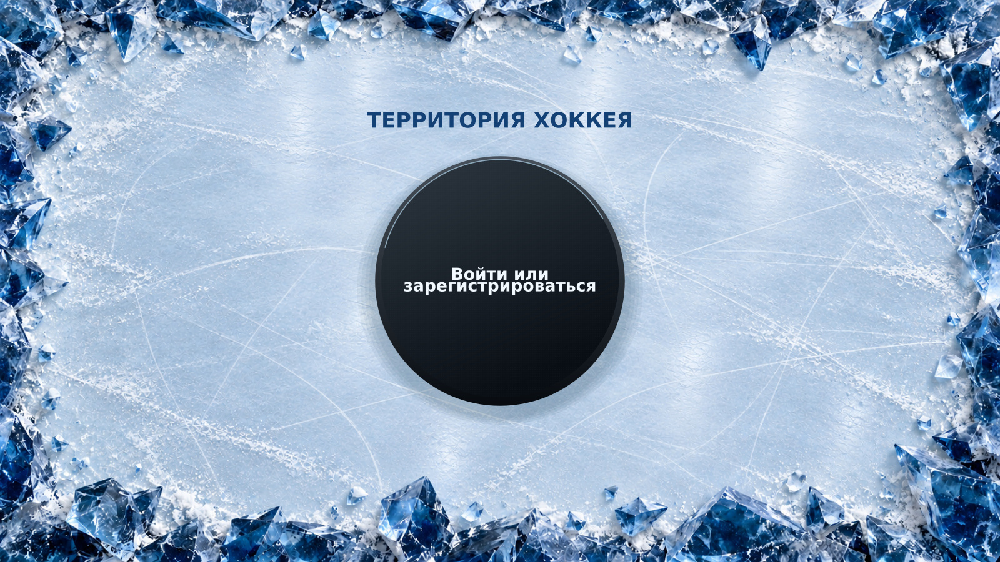
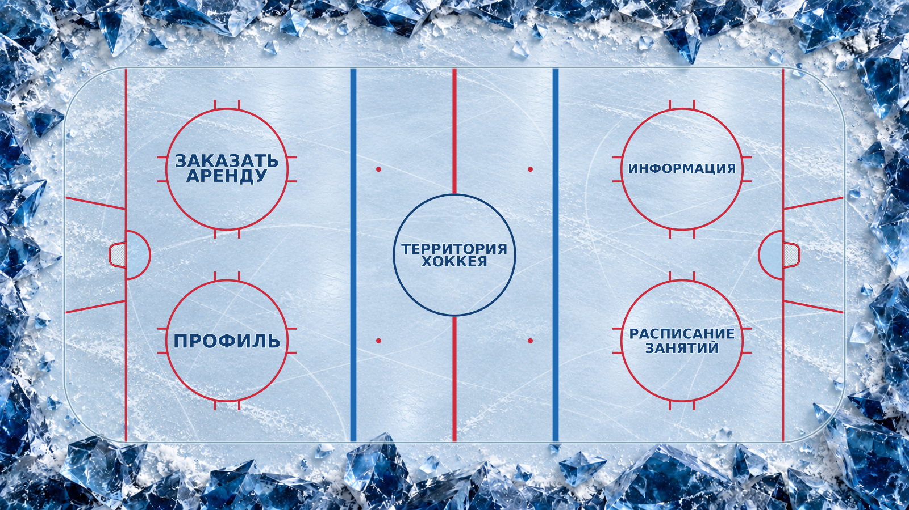

# Стартовый экран и меню «ТЕРРИТОРИЯ ХОККЕЯ»

Обновлён существующий проект Windows Forms на C# и .NET 10.

## Что изменено

- При запуске появляется хоккейный стартовый экран с шайбой по центру. Внутри шайбы — кнопка «Войти или зарегистрироваться». Нажатие мышью, Enter или пробелом открывает главное меню в том же окне.
- Сейчас это только переход между двумя экранами: формы регистрации, проверки учётных данных и сохранения пользователей нет.
- Центральная красная линия сплошная выше и ниже центрального круга; внутрь круга не заходит.
- Ворота показаны сверху: округлая задняя сетка, глубина каркаса, красная передняя перекладина и голубая площадь ворот.
- У четырёх кнопок главного меню убраны синие рамки и цветные подложки. Под текстом при каждой перерисовке копируется соответствующий участок льда, включая наведение и нажатие. Область нажатия круглая.
- Надписи увеличены: размер рассчитывается по контурам букв и расстоянию до края круга.
- Лёд слегка голубоватый, с более реалистичной фактурой: тонкие прорези лезвий, дуги от коньков, мягкие блики и небольшие скопления снежной крошки. Фактура остаётся видна под разметкой и кнопками.
- Усы сверху, снизу, справа и слева каждого из четырёх кругов вбрасывания примыкают к окружности без зазора. Их начало рассчитывается по уравнению окружности: внутренняя область круга остаётся свободной. У центрального круга усов нет.
- За обоими воротами добавлены две красные наклонные линии вратарской трапеции, расширяющейся к заднему борту.
- Окружности и красная разметка утолщены с 3 до 4,2 единицы, синие линии зон — с 9 до 12, центральная красная линия — с 6 до 8. При изменении окна вся разметка масштабируется вместе с площадкой.
- По краям — острые тёмно-синие ледяные выступы со снежной крошкой: часть направлена внутрь, часть выступает вверх к наблюдателю.

## Запуск

1. В GitHub Desktop выполни **Fetch origin → Pull origin**.
2. Открой [LP_PopovD_App.slnx](LP_PopovD_App/LP_PopovD_App.slnx) в **Visual Studio 2026** с рабочей нагрузкой **«Разработка классических приложений .NET»** и .NET 10.
3. Нажми **F5**.

**Esc** закрывает приложение, **F11** переключает полноэкранный и оконный режимы. Шайба остаётся по центру при изменении окна. Кнопка на шайбе открывает главное меню; четыре кнопки главного меню пока остаются без переходов.

| Место | Надпись |
|---|---|
| Центр | ТЕРРИТОРИЯ ХОККЕЯ |
| Левый верхний круг | ЗАКАЗАТЬ АРЕНДУ |
| Левый нижний круг | ПРОФИЛЬ |
| Правый верхний круг | ИНФОРМАЦИЯ |
| Правый нижний круг | РАСПИСАНИЕ ЗАНЯТИЙ |

## Файлы

- `Form1.cs` — переключение стартового экрана и главного меню, полноэкранный режим, расположение кнопок и кэширование фоновой сцены.
- `Form1.Designer.cs` — стартовая кнопка и четыре кнопки главного меню.
- `EntryDrawing.cs` — оформление стартового экрана и отрисовка шайбы средствами C#.
- `PuckButton.cs` — круглая кнопка-шайба с надписью «Войти или зарегистрироваться».
- `RinkDrawing.cs` — разметка, ворота и внешние усы кругов.
- `RinkTypography.cs` — подгонка контуров букв под круг.
- `RinkMenuButton.cs` — круглая область нажатия, подсветка и общий фон без рамок.
- [Assets/IceFrame.jpg](LP_PopovD_App/Assets/IceFrame.jpg) — изображение льда и обрамления; встроено в сборку приложения.
- [Assets/IceFrame.prompt.txt](LP_PopovD_App/Assets/IceFrame.prompt.txt) — полные запросы редактирования фонового изображения встроенным генератором изображений.
- `Menu_Preview.jpg` — предварительный вид сцены по геометрии приложения.
- `Entry_Preview.jpg` — предварительный вид стартового экрана.

## Разметка за воротами

Ориентир — официальные правила IIHF 2026/27, пункты 1.8 и 27.7, схема на странице 227. Две красные наклонные линии соединяют линию ворот с задним бортом; ширина трапеции увеличивается от 6,80 м до 8,60 м. В схематичной площадке приложения сохранено это соотношение ширин.

Ограничение касается игры вратаря с шайбой за линией ворот, а не самого нахождения вратаря за пределами трапеции.

[IIHF Official Rule Book 2026/27](https://blob.iihf.com/iihf-media/iihfmvc/media/downloads/rule%20book/2026-27_iihf_rule_book.pdf).

## Проверка

Сборка Release для Windows: **0 ошибок и 0 предупреждений**. Проверено включение изображения в ресурсы приложения. Предварительные изображения проверены для экранов 1600×900, 1366×768 и 1024×768.

Сборка выполнялась в Linux с `EnableWindowsTargeting=true`. Само окно Windows здесь не запускалось. Предварительные изображения не являются скриншотами запущенного окна; в приложении используется Segoe UI, в предпросмотре — доступный шрифт с кириллицей.

Проверка в Windows: после F5 видна центральная шайба; нажатие на неё открывает меню с четырьмя кнопками. После F11 компоновка обоих экранов должна сохраняться, Esc должен закрывать приложение.

## Документация

- [Microsoft: Windows Forms](https://learn.microsoft.com/dotnet/desktop/winforms/get-started/create-app-visual-studio).
- [Microsoft: отрисовка элементов управления](https://learn.microsoft.com/dotnet/desktop/winforms/controls/custom-painting-drawing).
- [Microsoft: область формы элемента управления](https://learn.microsoft.com/dotnet/api/system.windows.forms.control.region).
