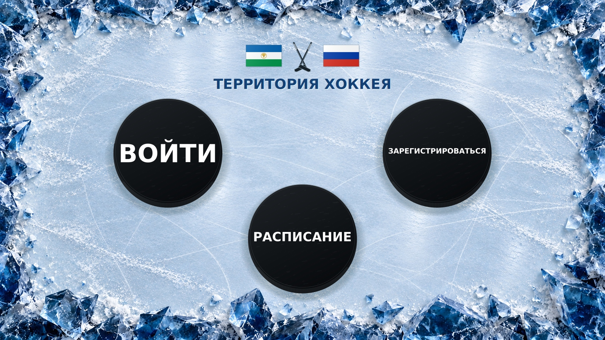
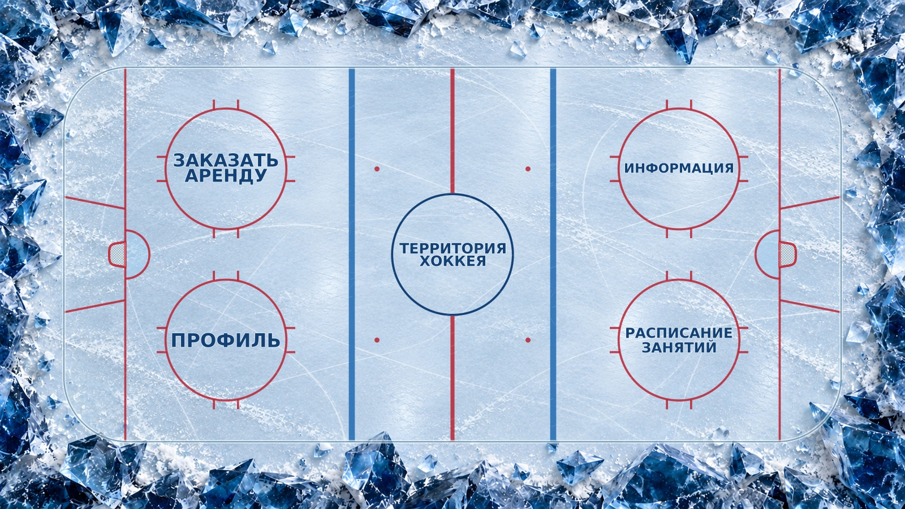

# «ТЕРРИТОРИЯ ХОККЕЯ» — приложение учебной практики

Проект Windows Forms на C# / .NET 10. Все файлы приложения размещаются в
`COURSE_3/EP_TPaD_DB/App_C#`. Материалы БД хранятся отдельно.



## Стартовый экран

- Слева — чёрная шайба **ВОЙТИ**, справа — **ЗАРЕГИСТРИРОВАТЬСЯ**.
- Снизу по центру — третья шайба **РАСПИСАНИЕ**.
- Все подписи белые, в одну строку. Контуры букв вписываются в лицо шайбы с минимальным безопасным отступом: длинная надпись имеет меньшую высоту, сохраняя максимальную ширину.
- Сверху по центру — **ТЕРРИТОРИЯ ХОККЕЯ**. Над названием — небольшие флаги Башкортостана и России, между ними — две клюшки, пересекающиеся нижними перьями.
- Шайбы имеют рифлёный торец, мелкую фактуру резины, потёртости, блик на кромке и мягкую тень. Реакции на наведение, фокус и нажатие сохранены; область нажатия круглая.
- Сохранены голубоватый лёд, следы коньков и кристаллическое обрамление из прежнего проекта.

Кнопки пока сохраняют поведение прежнего прототипа: открывают существующее главное меню.
При выборе «РАСПИСАНИЕ» фокус устанавливается на «РАСПИСАНИЕ ЗАНЯТИЙ».
**Проверка логина, регистрация пользователей, подключение БД и загрузка расписания ещё не реализованы.**
Это изменение оформления, а не готовая система авторизации.



## Разметка хоккейного поля

Сохранены ворота с сетками, площади ворот, вратарские трапеции, четыре круга
вбрасывания с примыкающими усами и центральный круг без красной линии внутри.
Краска стала слегка прозрачной; поверх неё добавлены тонкие прорези и дуги от
коньков, чтобы разметка воспринималась под слоем льда. Толщина линий и геометрия
масштабируются вместе с площадкой.

## Качество и изображения 16K

- [Entry_16K.jpg](Entry_16K.jpg) — стартовый экран **15360×8640**.
- [Menu_16K.jpg](Menu_16K.jpg) — главное меню **15360×8640**.
- `Entry_Preview.jpg` и `Menu_Preview.jpg` — версии 1600×900 для быстрого просмотра.

Шайбы, надписи, флаги, клюшки и разметка отрисованы средствами C# непосредственно
в целевом разрешении. Исходный фон `App/Assets/IceFrame.jpg` имеет размер
1672×941 и масштабируется с качественной бикубической интерполяцией. Экспорт
в 16K не добавляет к исходной фотографии льда настоящие новые детали.
Для размещения в репозитории изображения 16K сохранены как прогрессивные JPEG
с оптимизацией: качество 87 для стартового экрана и 85 для главного меню.
Это уменьшает объём до примерно 12 МБ на изображение без изменения разрешения.
Команды экспорта ниже позволяют получить локальные версии с качеством JPEG 98.
Изображения используют ту же отрисовку, что и приложение; это экспорт сцены,
а не снимки запущенного окна Windows. В Linux используется доступная замена
Segoe UI, поэтому формы букв могут немного отличаться от Windows.

Окно рисуется в разрешении текущего экрана. Файлы 16K не загружаются в него
как огромный фон. Фоновая сцена кэшируется до изменения размеров или экрана.

## Запуск в Visual Studio

1. В GitHub Desktop нажми **Fetch origin → Pull origin**.
2. Открой [App/LP_PopovD_App.slnx](App/LP_PopovD_App.slnx) в **Visual Studio 2026**.
3. Нужны .NET 10 и рабочая нагрузка **«Разработка классических приложений .NET»**.
4. Нажми **F5**.

**F11** переключает полный экран и окно, **Esc** закрывает приложение.
**Tab** переключает кнопки, **Enter / пробел** активируют выбранную кнопку.

Для повторного экспорта в Windows из папки `App`:

```powershell
dotnet run -c Release -- --export-entry ..\Entry_16K.jpg
dotnet run -c Release -- --export-menu ..\Menu_16K.jpg
```

Третий аргумент задаёт ширину от 960 до 15360 пикселей, например:

```powershell
dotnet run -c Release -- --export-entry ..\Entry_Preview.jpg 1600
```

Экспорт выполняется небольшими плитками, чтобы ограничить временные буферы.
Итоговое изображение 16K занимает около 380 МиБ памяти без учёта накладных расходов.

## Основные файлы

| Файл | Назначение |
|---|---|
| `App/Form1.cs` | Расположение кнопок, смена экранов, полный экран, кэш сцены |
| `App/Form1.Designer.cs` | Три стартовые кнопки и четыре кнопки главного меню |
| `App/EntryDrawing.cs` | Стартовая сцена и реалистичные шайбы |
| `App/HeaderDrawing.cs` | Заголовок, флаги и скрещённые клюшки |
| `App/SceneDrawing.cs` | Общая отрисовка окна и экспорт изображений |
| `App/PuckButton.cs` | Интерактивная кнопка-шайба |
| `App/RinkDrawing.cs` | Разметка, ворота, трапеции и следы поверх линий |
| `App/RinkTypography.cs` | Подгонка букв под круг |
| `App/RinkMenuButton.cs` | Круглая область нажатия и реакции на ввод |
| `App/Program.cs` | Запуск приложения и команды экспорта |
| `App/Assets/IceFrame.jpg` | Исходная фактура льда и обрамление |

## Проверка

Release-сборка выполнена для Windows в Linux с `EnableWindowsTargeting=true`.
Результат: **0 ошибок, 0 предупреждений**. Проверены экспорт 1600×900,
компоновка 960×600 и изображения 15360×8640.
Окно WinForms в Windows в этой среде не запускалось. Экспорт проверяется отдельно
через общие классы отрисовки с System.Drawing; они не требуют запуска формы.
