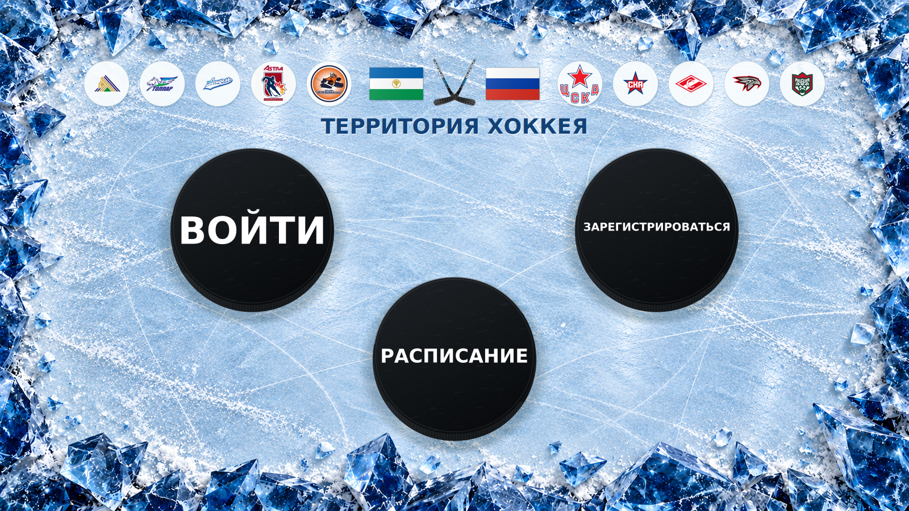
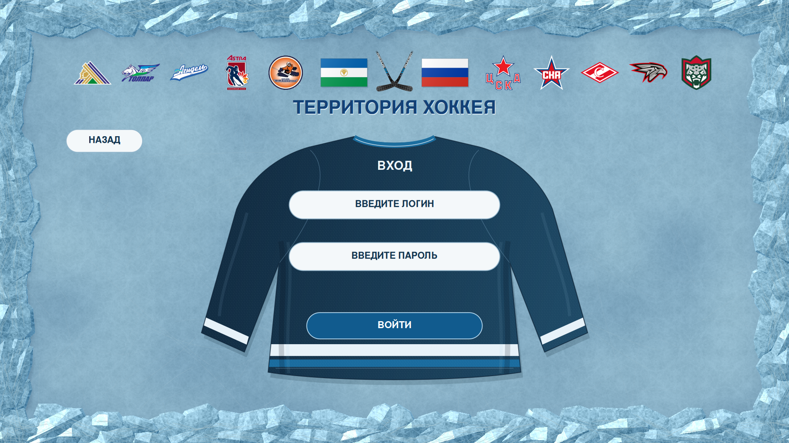
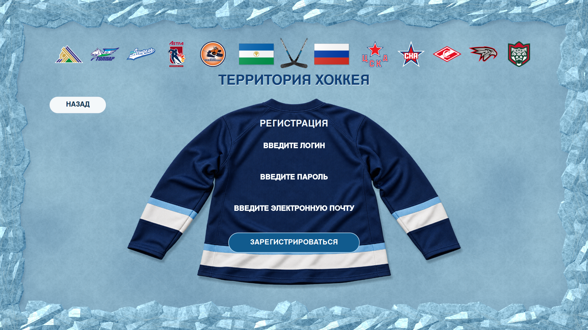
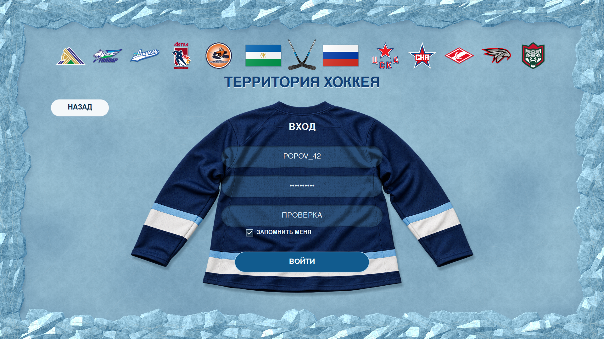
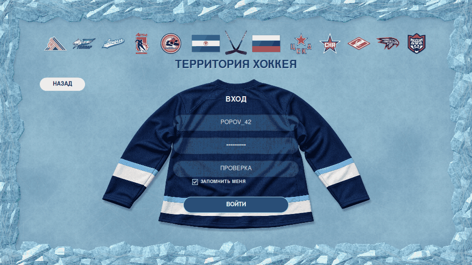
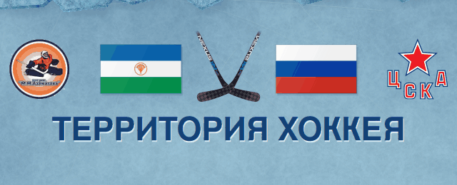
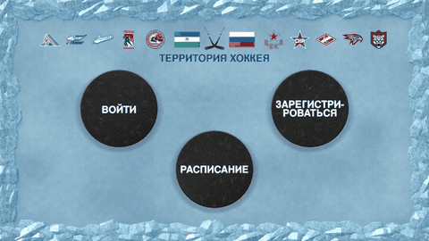
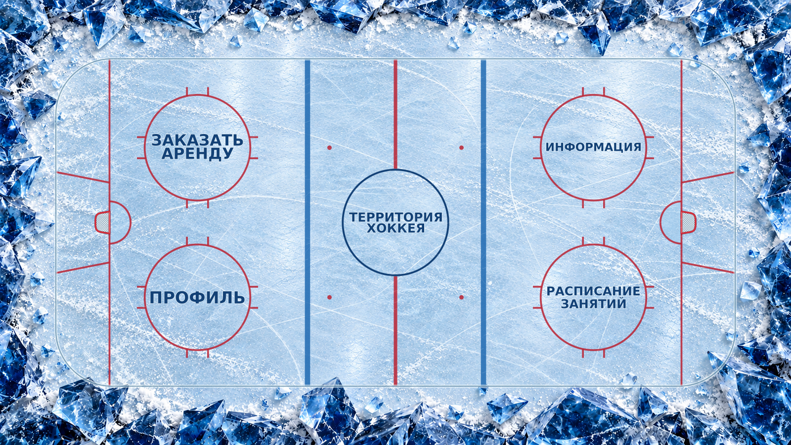

# «ТЕРРИТОРИЯ ХОККЕЯ» — приложение учебной практики

Настольное приложение Windows Forms, C# / .NET 10.
Все файлы приложения находятся в `COURSE_3/EP_TPaD_DB/App_C#`.

## Стартовый экран



Три круглые шайбы: слева **ВОЙТИ**, справа **ЗАРЕГИСТРИРОВАТЬСЯ**, снизу **РАСПИСАНИЕ**.
На всех трёх используется один максимально допустимый размер букв.
Его ограничивает самая требовательная надпись, по реальным контурам букв и радиусу шайбы.
Надпись регистрации перенесена на две строки; короткие слова не растягиваются отдельно.

У поверхности шайб фотографическая фактура вулканизированной резины: поры, потёртости,
небольшие надрезы по всей площади. Разные повороты материала дают каждой шайбе свой
рисунок. Малые сколы распределены по всей окружности. Пунктирной рамки фокуса нет.

Над названием приложения эмблемы и флаги стоят по одной горизонтали.
Порядок **слева направо**:

**Салават Юлаев → Толпар → Агидель → Астра → школа М. М. Азаматова →
флаг Башкортостана → клюшки → флаг России → ЦСКА → СКА → Спартак → Авангард → Ак Барс.**

Эмблемы показаны целиком, без подложек и круглых масок, с сохранением пропорций
и исходных цветов. Лёгкая контактная тень даёт эмблемам глубину без изменения символики.
Разный DPI файлов не влияет на их размер.

## Вход и регистрация



Кнопка **ВОЙТИ** открывает отдельный экран с задней стороной хоккейной майки.
На её спине расположены овальные поля логина и пароля, флажок **ЗАПОМНИТЬ МЕНЯ**
и кнопка **ПРИСЛАТЬ КОД**.
Подсказка исчезает при фокусе, после чего можно вводить текст.
Если поле осталось пустым, подсказка возвращается после ухода фокуса.



Регистрация использует ту же майку, размеры полей и стиль; добавлено поле электронной почты.
Эмблемы клубов, флаги и название приложения остаются сверху в обоих случаях.

Майка использует фотореалистическую основу: тяжёлая сетчатая ткань, естественные складки
на рукавах и спинке, усиленные плечевые швы, вязаный воротник, объёмные манжеты и подгибка.
Мягкая тень отделяет ткань от льда. Все поля целиком помещаются на широкой спинке.
По последнему указанию пользователя возвращены овальные тканевые вставки в тон майки.
Их материал сохраняет освещение, сетчатую фактуру и складки спинки; внутренняя тень
придаёт краю небольшую глубину. Контурные строчки и пунктирные рамки удалены.
Нативный TextBox получает фон из того же фрагмента сцены
через кисть Windows GDI; сплошная прямоугольная заливка под текстом не используется.
Фон кисти обновляется при перемещении, изменении размеров поля и обновлении сцены;
GDI-объекты освобождаются.
[Jersey_Fields_Detail_32K.png](Jersey_Fields_Detail_32K.png) показывает край тканевой вставки
в масштабе 1:1: это фрагмент 1600 × 1200 из отрисовки 30720 × 17280.

**Постоянное правило пользователя:** у полей и кнопок запрещены пунктирные, прерывистые и точечные
контуры во всех состояниях, включая фокус с клавиатуры. Правило закреплено в [AGENTS.md](AGENTS.md).
В крупном экспорте мелкое плетение дополнительно рассчитывается в целевых пикселях;
отрисовывается только видимая полоса, без выделения памяти под всю майку в 32K.
[Jersey_Detail_32K.png](Jersey_Detail_32K.png) — фрагмент 1600 × 1200 из кадра
30720 × 17280 в масштабе 1:1. Основа создана встроенным ImageGen с прозрачным фоном;
её исходный размер — 1536 × 1024, [полный запрос](App/Assets/JerseyBack.prompt.txt).

Это настоящие элементы ввода WinForms:
- пароль закрывается системными символами;
- поля доступны мышью и клавишей Tab;
- Enter отправляет форму на проверку;
- проверяются пустой логин, пустой пароль, непустой код и формат email регистрации;
- кнопка «НАЗАД» и Esc возвращают на стартовый экран;
- при уходе с формы пароль и код очищаются; логин восстанавливается только при включённом «Запомнить меня».

**Подключение к БД, реальная отправка писем и проверка учётных данных пока не реализованы.**
Вход работает как демонстрация; регистрация сообщает, что её сервис ещё не подключён.
Пароль и код не записываются в файлы и не отправляются по сети.

### Двухэтапный вход

1. Ввести логин и пароль. При необходимости включить **ЗАПОМНИТЬ МЕНЯ**.
2. Нажать **ПРИСЛАТЬ КОД**. После оборота клюшек плавно появляется третье поле,
   кнопка меняется на **ВОЙТИ**. Подсказка прямо сообщает о тестовом режиме.
3. Ввести любой непустой текст в поле кода и нажать **ВОЙТИ**.
4. После оборота клюшек поля, пароль, код и кнопки растворяются в снежную пыль.
   Два потока несут снежинки к нижним левому и правому углам.
5. Логин остаётся на месте, получает небольшое белое свечение и короткие лучи от контуров букв.
   Затем он ускоряется вниз к ткани, слегка сжимается при контакте и становится надписью на майке.
   Освещение и мелкая фактура надписи берутся из ткани в месте приземления.
6. Из-под букв разлетается снежный порошок. После короткой выдержки открывается главное меню.





Сцена входа занимает 2600 мс, затем начинается переход в меню на 440 мс.
До конца сцены повторный запуск заблокирован. Esc отменяет сцену и возвращает поля;
проверку можно повторить. Изменение логина или пароля сбрасывает прежний запрос кода.
Изменение размеров окна отменяет текущую анимацию и подготавливает сцену для нового размера.

**ЗАПОМНИТЬ МЕНЯ** сохраняет только логин и флажок в локальных настройках Windows.
Пароль и код туда не входят. Снятие флажка удаляет прежние настройки; успешная демонстрация
с флажком восстанавливает логин при следующем запуске. Подтверждение кодом остаётся обязательным.
Ошибки чтения/записи настроек не закрывают приложение.

## Клюшки при нажатии кнопок



Каждое нажатие кнопки запускает один встречный оборот клюшек за **540 мс**.
Ледяная дуга заменена вихрем из отдельных снежинок и полупрозрачных облачков порошка:
частицы имеют разный размер, скорость, срок жизни и короткий след движения.
Клюшки плавно ускоряются и замедляются, возвращаясь в исходную позу.

Срабатывает общий Click, включая Enter и Space. Сначала заканчивается полный оборот,
потом выполняется действие кнопки. Повторное нажатие не подменяет действие; Esc отменяет его.
Отсчёт начинается с первого нарисованного кадра.

Изображения клюшек заранее уменьшены до экранного размера. Во время оборота
используются готовый снимок интерфейса и небольшой изменяемый участок между флагами.
Поля в этот момент скрыты за снимком; вид пароля остаётся маскированным.
Флаги и остальной фон не перерисовываются эффектом. На главном меню пара плавно появляется
на время оборота и исчезает до начала камеры.

## Переход между экранами



Переход длится **440 мс**. Камера приближается к нажатой кнопке и раскрывает следующий экран;
по краям проходит снежный поток. Непрозрачный первый слой устраняет тёмный провал между экранами.
Появление поля кода использует отдельное мягкое раскрытие за **200 мс**.

Фон, майка и варианты форм подготавливаются последовательно в фоновом потоке.
UI получает готовые изображения; растеризация ткани не выполняется внутри анимационного кадра.
Шайбы кэшируют своё оформление, клюшки — небольшие прозрачные изображения.
Для движущейся камеры используется ограниченный рабочий буфер; неподвижные экраны,
начальный и конечный кадры, а также экспорт сохраняют полное разрешение.
Положение рассчитывается по монотонным часам, поэтому пропуск кадра не растягивает анимацию.

Кнопка **РАСПИСАНИЕ** открывает главное меню и устанавливает фокус на **РАСПИСАНИЕ ЗАНЯТИЙ**.
Загрузка самого расписания, аренда и профиль относятся к следующим этапам.



## Чёткость фона

`NativeIceDrawing.cs` создаёт лёд сразу в разрешении окна или экспорта:
многослойная фактура замёрзшей воды, следы коньков и снежная крошка.
По краям лежат объёмные сколотые глыбы со смещёнными острыми вершинами,
узкими кромками, разными сколами, бликами, контактными тенями, внутренними трещинами и инеем.
Габариты каждой глыбы увеличены в **1,40 раза** относительно предыдущего варианта.
Верхняя граница роста высоты острой вершины — **1,468 раза**; ограничение 1,5 не превышается.
Иней приглушает блики, а шероховатость граней различается у разных глыб.
Вместо прежних плоских многоугольников используется поле высот с нормалями и направленным освещением.

В 30720 × 17280 фон вычисляется в координатах 30720 × 17280.
Для материала используется [IceSurface.png](App/Assets/IceSurface.png),
созданный встроенным imagegen; [полный запрос](App/Assets/IceSurface.prompt.txt).
Материал накладывается повторно в нескольких масштабах, а не растягивается на весь экран.
MIP-уровень подавляет муар при уменьшении; нормали и мелкий рельеф рассчитываются отдельно.
В [Ice_Detail_32K.png](Ice_Detail_32K.png) показан фрагмент 1600 × 1200 из отрисовки
кадра 30720 × 17280 в масштабе 1:1, чтобы рассмотреть острые грани и фактуру.
Кэш переносится на экран 1:1 без повторной фильтрации.
Композиция майки, дополнительное плетение, поля, надписи и разметка строятся в целевом разрешении.
Собственная детализация растровых эмблем, резины, основы майки и исходного материала льда
ограничена исходниками; размер готового кадра не превращает их в изображения 32K.
Окно рисуется в разрешении монитора; экран Full HD или 4K физически не показывает все пиксели 32K.

Прежние `Assets/IceFrame.*` сохранены как архив, но PNG фона исключён из сборки
и не участвует в отрисовке. Источники текущих изображений — в [ASSETS.md](ASSETS.md).

## Запуск в Visual Studio

1. В GitHub Desktop: **Fetch origin → Pull origin**.
2. Открыть [App/LP_PopovD_App.slnx](App/LP_PopovD_App.slnx) в Visual Studio 2026.
3. Установить .NET 10 и нагрузку «Разработка классических приложений .NET».
4. Нажать F5.

F11 переключает полноэкранный и оконный режимы.
F12 открывает сохранение текущего экрана в PNG **30720 × 17280**.
Экспорт выполняется отдельным процессом, окно остаётся доступным.
Сохраняется оформление с пустыми полями и подсказками, введённые данные в экспорт не попадают.
Esc возвращает назад; на стартовом экране закрывает приложение.

## Экспорт 32K

Размер по умолчанию — **30720 × 17280**, 530 841 600 пикселей, формат RGB PNG без потерь.
Фон, композиция майки, поля, текст и разметка рассчитываются заново в этом размере.
Это не увеличение PNG-превью 1920 × 1080.

Для экспорта всех четырёх экранов в Windows запустить из папки `App_C#`:

```powershell
.\Export-32K.ps1
```

Скрипт собирает приложение Release и сохраняет `Entry_32K.png`,
`Login_32K.png`, `Registration_32K.png`, `Menu_32K.png` в папку `Exports32K`.
Другую папку можно передать параметром `-OutputDirectory`.
Большие PNG не включаются в репозиторий; их можно воспроизвести этим скриптом или через F12.

Весь кадр не хранится в памяти. Фон рассчитывается полосами по 256 строк;
одна полоса используется для всех четырёх экранов. `PngRowWriter.cs` последовательно
записывает строки с фильтрами Up/Paeth и zlib-сжатием, формирует CRC каждого блока.
Итоговый файл заменяется только после записи всех строк и завершения PNG;
при сбое незавершённый файл удаляется, предыдущий готовый файл сохраняется.

Для всех экранов из папки `App`:

```powershell
dotnet run -c Release -- --export-all ..\Exports32K
```

Для отдельного экрана ширину можно не указывать:

```powershell
dotnet run -c Release -- --export-entry ..\Entry_32K.png
dotnet run -c Release -- --export-login ..\Login_32K.png
dotnet run -c Release -- --export-registration ..\Registration_32K.png
dotnet run -c Release -- --export-menu ..\Menu_32K.png
```

16K сохраняется прежним `Export-16K.ps1` или командой
`dotnet run -c Release -- --export-all ..\Exports16K 15360`.

PNG-превью всех четырёх экранов имеют размер 1920 × 1080.
Это экспорт общих классов отрисовки, а не снимки запущенного окна Windows.
В Linux используется замена Arial; вид букв в Windows может немного отличаться.

Для небольших превью из папки `App` нужно явно передать ширину:

```powershell
dotnet run -c Release -- --export-entry ..\Entry_Preview.png 1920
dotnet run -c Release -- --export-login ..\Login_Preview.png 1920
dotnet run -c Release -- --export-registration ..\Registration_Preview.png 1920
dotnet run -c Release -- --export-menu ..\Menu_Preview.png 1920
```

Для PNG можно задать ширину от 960 до 30720 пикселей, высота вычисляется для 16:9.
JPEG поддерживается до 15360 пикселей по ширине; для 32K нужен PNG.
Сохранение большого изображения занимает время и создаёт большой файл.
Команда возвращает код 0 при успешном сохранении и 1 с сообщением об ошибке при сбое.

## Проверка

- Windows Release-сборка: **0 ошибок, 0 предупреждений**.
- **31 проверка поведения**: обязательные поля, демонстрационный код, защита от повторного запуска,
  отмена и повтор, отсчёт оборота с первого кадра, восстановление и удаление настроек,
  повреждённые файлы и последовательность конкурирующих записей.
- **104 проверки кэша сцен**: отмена ожидающих задач при пересоздании окна, повторное освобождение,
  обращения к старому кэшу, сохранение рабочих кадров и настоящих ошибок отрисовки.
  Штатная отмена теперь завершается без исключений, на которых останавливался отладчик Visual Studio.
- Кадры форм и анимаций проверены в 960 × 540, 1920 × 1080 и 3840 × 2160.
- Проверены длинный логин из 64 символов, кириллица, короткий логин и Unicode.
- Проверены прозрачность слоёв, исчезновение вставок, сохранность флагов,
  совпадение исходной и конечной позы клюшек.
- Превью созданы общими классами отрисовки приложения; это отрисованные кадры, а не запись окна Windows.

Запуск проверок логики:

```powershell
dotnet run --project Tests/StateChecks.csproj -c Release
```

Проверки кэша сцен в Windows:

```powershell
dotnet run --project Tests/SceneCacheChecks.csproj -c Release
```

Проверка самих WinForms-контролов в Windows:

```powershell
dotnet run --project Tests/WinFormsChecks.csproj -c Release
```

Этот тест проверяет повторное назначение масштаба, живые шрифты, снимки и отрисовку
чекбокса, кнопки и полей ввода. Он добавлен после ошибки отрисовки «Запомнить меня».
Проект теста собран без предупреждений; его выполнение требует Windows и в этой Linux-среде не проверено.

Замеры отрисовки и границы проверки указаны в [PERFORMANCE.md](PERFORMANCE.md).
Само окно WinForms в Windows в этой среде не запускалось. Замеры Linux/libgdiplus
не являются измерением FPS на пользовательском ПК.
